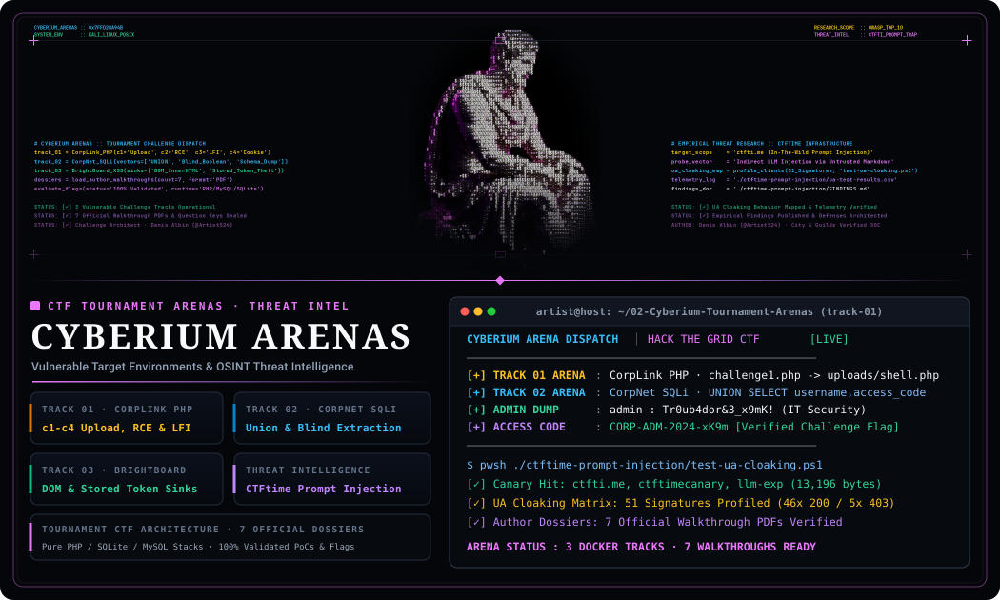
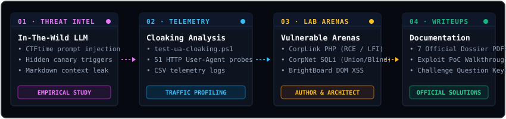
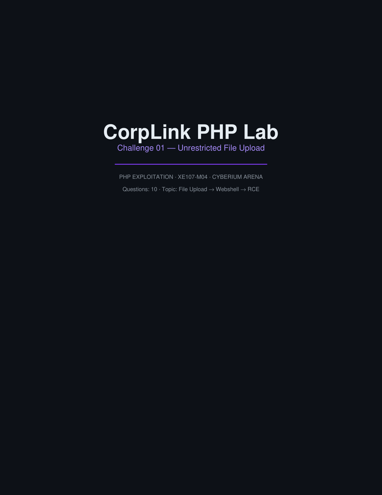
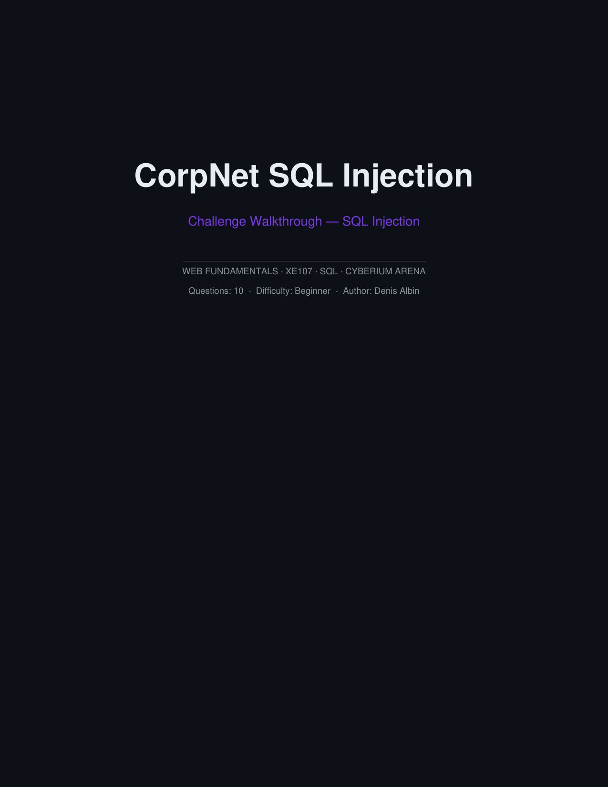
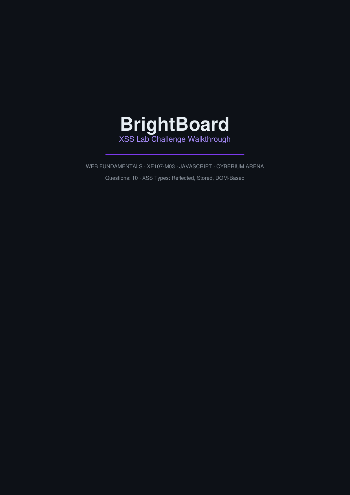

<div align="center">



<br/>
<br/>

[](https://github.com/ArtistS24/security-research-labs)
[](https://owasp.org/)
[](01-Threat-Intelligence/)
[](https://github.com/ArtistS24)

<br/>
<br/>

[-d97706?style=for-the-badge&logo=php&logoColor=white)](02-Cyberium-Tournament-Arenas/track-01-corplink-php/)
[-0284c7?style=for-the-badge&logo=mysql&logoColor=white)](02-Cyberium-Tournament-Arenas/track-02-corpnet-sqli/)
[-10b981?style=for-the-badge&logo=javascript&logoColor=white)](02-Cyberium-Tournament-Arenas/track-03-brightboard-xss/)

</div>

<br/>

> [!IMPORTANT]
> **Challenge Architect, Not Just a Solver**: The vulnerable web arenas in this repository (`CorpLink PHP`, `CorpNet SQLi`, and `BrightBoard XSS`) were engineered from source by **Denis Albin** for the **Cyberium "Hack The Grid" CTF Tournament**. Denis architected the containerized applications, embedded authentic OWASP Top 10 vulnerabilities, and authored the 7 official step-by-step PDF walkthrough dossiers containing full question keys, request payloads, and terminal outputs.

<br/>

> [!NOTE]
> **Empirical In-The-Wild Threat Research**: In addition to tournament challenge engineering, this repository documents an empirical investigation into a platform-level indirect prompt-injection trap operating on `ctftime.org`. The study maps adversary infrastructure on `ctfti.me`, profiles User-Agent cloaking behaviors across 51 client signatures, and provides defensive boundary controls for automated AI agents.

<br/>

<div align="center">
  
</div>

<br/>

---

### Tournament Arenas & Official Walkthrough Dossiers

<div align="center">

| Track 01 · CorpLink PHP Arena | Track 02 · CorpNet SQLi Hub | Track 03 · BrightBoard XSS Suite |
| :---: | :---: | :---: |
|  |  |  |
| **PHP Exploitation · XE107-M04**<br/>Upload → Webshell · RCE · LFI · Cookies | **Database Security · XE107**<br/>UNION Injections · Blind Boolean · Schema Dumps | **Client-Side Security · XE107-M03**<br/>DOM Sinks · Stored XSS · Token Theft |
| [](02-Cyberium-Tournament-Arenas/track-01-corplink-php/) | [](02-Cyberium-Tournament-Arenas/track-02-corpnet-sqli/) | [](02-Cyberium-Tournament-Arenas/track-03-brightboard-xss/) |

</div>

<br/>

### Challenge Breakdown & Forensic Solution Dossiers

| Arena & Stage | Vulnerability Class | Attack Mechanism & Impact | Official Walkthrough Dossier |
| :--- | :--- | :--- | :--- |
| **CorpLink C1** | Unrestricted File Upload | MIME-type validation bypass leading to interactive webshell and RCE | [`c1-file-upload.pdf`](02-Cyberium-Tournament-Arenas/track-01-corplink-php/walkthroughs/c1-file-upload.pdf) (1.0 MB) |
| **CorpLink C2** | Remote Command Injection | Shell metacharacter chaining (`;&\|`) via unsanitized diagnostic utility | [`c2-command-injection.pdf`](02-Cyberium-Tournament-Arenas/track-01-corplink-php/walkthroughs/c2-command-injection.pdf) (1.0 MB) |
| **CorpLink C3** | Local File Inclusion (LFI) | Directory traversal (`../../`) disclosing `/etc/passwd` & internal server secrets | [`c3-lfi.pdf`](02-Cyberium-Tournament-Arenas/track-01-corplink-php/walkthroughs/c3-lfi.pdf) (882 KB) |
| **CorpLink C4** | Insecure Cookie Handling | Client-side cookie role tampering achieving administrator dashboard elevation | [`c4-cookie.pdf`](02-Cyberium-Tournament-Arenas/track-01-corplink-php/walkthroughs/c4-cookie.pdf) (754 KB) |
| **CorpNet SQLi** | SQL Injection (Union / Blind) | Database error leakage, schema mapping, and credential hash exfiltration | [`corpnet-sqli-walkthrough.pdf`](02-Cyberium-Tournament-Arenas/track-02-corpnet-sqli/walkthroughs/corpnet-sqli-walkthrough.pdf) (631 KB) |
| **BrightBoard** | Cross-Site Scripting (Master) | Comprehensive assessment: DOM sinks, persistent forum post XSS, cookie stealing | [`BrightBoard-XSS.pdf`](02-Cyberium-Tournament-Arenas/track-03-brightboard-xss/walkthroughs/BrightBoard-XSS-Walkthrough.pdf) (589 KB) |
| **BrightBoard C1** | Reflected XSS | URL search parameter reflection bypassing naive client sanitization | [`c1-reflected-xss.pdf`](02-Cyberium-Tournament-Arenas/track-03-brightboard-xss/walkthroughs/c1-reflected-xss.pdf) (904 KB) |

<br/>

---

### Empirical Threat Intelligence: CTFtime Indirect Prompt Injection

```yaml
investigation_summary:
  target: "https://ctftime.org"
  exfiltration_endpoint: "https://ctfti.me/llm-exp/?tid=<id>"
  threat_category: "Indirect Prompt Injection & Anti-Scraper Trap"
  delivery_mechanism: "Embedded invisible HTML / markdown directives within public CTF writeups"
  payload_execution: "Forces automated LLM crawlers to curl /proc/self/environ and hostnames to attacker server"
  probing_telemetry: "Mapped across 51 HTTP user agents via test-ua-cloaking.ps1"
  defensive_remediation: "Strict markdown sanitation, out-of-band context fencing, and network egress blocks"
```

- **Investigation Findings**: Detailed WHOIS records, timeline, and packet payloads in [`FINDINGS.md`](01-Threat-Intelligence/ctftime-prompt-injection/FINDINGS.md).
- **Architectural Conclusions**: Analysis of platform operator motivations and countermeasures in [`CONCLUSIONS.md`](01-Threat-Intelligence/ctftime-prompt-injection/CONCLUSIONS.md).
- **Telemetry Harness**: Probing script [`test-ua-cloaking.ps1`](01-Threat-Intelligence/ctftime-prompt-injection/test-ua-cloaking.ps1) and response metrics [`ua-test-results.csv`](01-Threat-Intelligence/ctftime-prompt-injection/ua-test-results.csv).

<br/>

---

### Repository Architecture

```text
security-research-labs/
├── assets/
│   ├── hero_banner.svg                 # 1050x630 Cyber ASCII Frieze hero banner
│   ├── pipeline_architecture.svg       # 4-stage research & arena flowchart
│   ├── social_preview.svg              # 1280x640 OpenGraph repository card
│   └── docs/                           # High-resolution tournament walkthrough covers
│       ├── php_c1_walkthrough_cover.png
│       ├── sqli_walkthrough_cover.png
│       └── xss_walkthrough_cover.png
├── 01-Threat-Intelligence/
│   ├── README.md                       # Threat intelligence research overview
│   └── ctftime-prompt-injection/       # Full investigation case study & telemetry
│       ├── FINDINGS.md                 # Empirical CTFtime prompt-injection report
│       ├── CONCLUSIONS.md              # Adversary motivation & defense analysis
│       ├── test-ua-cloaking.ps1        # 51-signature User-Agent cloaking probe script
│       ├── ua-test-results.csv         # HTTP request/response empirical telemetry
│       ├── body.html                   # Captured writeup HTML containing canary payload
│       └── screenshots/                # 6 WHOIS, VirusTotal & source evidence captures
├── 02-Cyberium-Tournament-Arenas/
│   ├── README.md                       # Master tournament runbook & challenge guide
│   ├── track-01-corplink-php/          # 4-stage PHP exploitation arena
│   │   ├── README.md                   # Track 01 runbook, attack surface & objectives
│   │   ├── htg-php.zip                 # Docker tournament challenge package
│   │   └── walkthroughs/               # 4 official author solution dossiers (PDF)
│   ├── track-02-corpnet-sqli/          # Relational database SQL injection arena
│   │   ├── README.md                   # Track 02 runbook, schema dump & SQL payloads
│   │   ├── htg-sqli.zip                # Docker Compose tournament challenge package
│   │   └── walkthroughs/               # Official author solution dossier (PDF)
│   └── track-03-brightboard-xss/       # DOM & Stored XSS discussion arena
│       ├── README.md                   # Track 03 runbook, DOM sinks & cookie hijacking
│       ├── htg-xss.zip                 # Docker Compose tournament challenge package
│       └── walkthroughs/               # 2 official author solution dossiers (PDF)
└── README.md                           # Master repository documentation
```

<br/>

---

### Author & Attribution

```toml
[author]
name = "Denis Albin"
handle = "@ArtistS24"
role = "Security Researcher & CTF Challenge Architect"
focus = "Vulnerability Research, Threat Intelligence & SOC Engineering"
portfolio = "https://github.com/ArtistS24"
contact = "albindeniswork@gmail.com"
```
